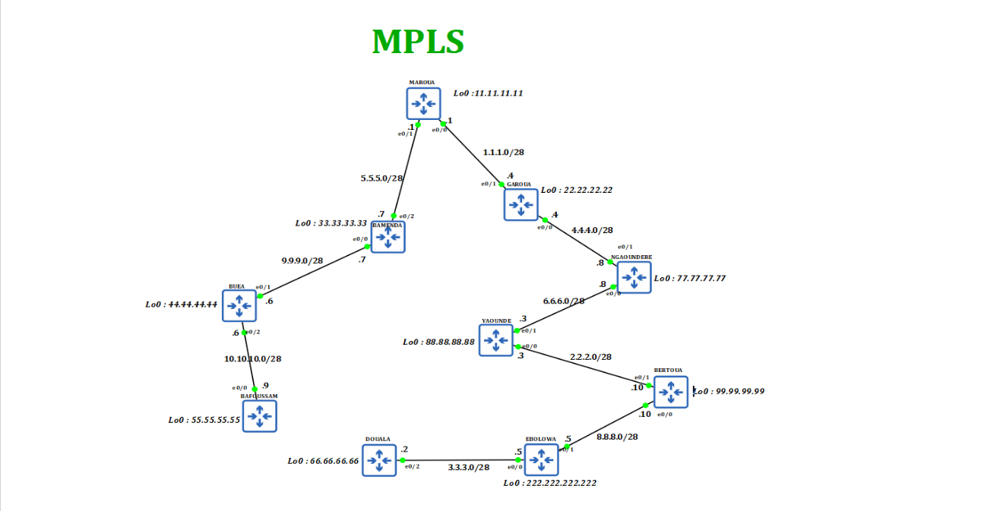

# 🏷️ Simulation d'un Backbone MPLS (LDP & OSPFv2) — 10 Routeurs Cisco IOS


Conception, implémentation et analyse complète de la commutation d'étiquettes **MPLS (*Multiprotocol Label Switching*)** sur une dorsale opérateur reliant **10 routeurs LSR (*Label Switch Routers*)** représentant les dix chefs-lieux régionaux du Cameroun sous Cisco IOS et **EVE-NG**. Ce laboratoire valide l'IGP sous-jacent **OSPFv2**, l'activation de **CEF**, la signalisation **LDP (*Label Distribution Protocol*)** avec plages d'étiquettes dédiées par routeur, l'inspection des tables **LIB** et **LFIB**, ainsi que le mécanisme de **PHP (*Penultimate Hop Popping*)**.

---

## 📑 Table des Matières

1. [Architecture & Topologie](#-architecture--topologie)
2. [Plan d'Adressage IP & Plages de Labels LDP](#-plan-dadressage-ip--plages-de-labels-ldp)
3. [Mécanismes MPLS Déployés & Analysés](#-mécanismes-mpls-déployés--analysés)
4. [Structure du Dépôt](#-structure-du-dépôt)
5. [Commandes de Vérification & Diagnostic](#-commandes-de-vérification--diagnostic)
6. [Auteur & Encadrement](#-auteur--encadrement)

---

## 📐 Architecture & Topologie



L'infrastructure s'articule autour d'une dorsale linéaire à deux branches convergeant vers **`MAROUA`** (`Lo0: 11.11.11.11/32`) :
* **Branche Ouest :** `MAROUA` $\leftrightarrow$ `BAMENDA` $\leftrightarrow$ `BUEA` $\leftrightarrow$ `BAFOUSSAM`.
* **Branche Est-Sud :** `MAROUA` $\leftrightarrow$ `GAROUA` $\leftrightarrow$ `NGAOUNDERE` $\leftrightarrow$ `YAOUNDE` $\leftrightarrow$ `BERTOUA` $\leftrightarrow$ `EBOLOWA` $\leftrightarrow$ `DOUALA`.

Toutes les interconnexions point-à-point utilisent des sous-réseaux **`/28`**, tandis que chaque routeur dispose d'une interface **`Loopback0` (`/32`)** servant à la fois d'identifiant de routeur OSPF et de **LDP Router-ID** (`mpls ldp router-id loopback 0`).

---

## 📊 Plan d'Adressage IP & Plages de Labels LDP

| Routeur (LSR) | Loopback0 (`/32`) | Plage de Labels LDP | Interfaces & Adresses IP (`/28`) | Voisins LDP Directs |
| :--- | :---: | :---: | :--- | :--- |
| **`MAROUA`** | `11.11.11.11` | `100 – 199` | `e0/0`: `1.1.1.1` (Garoua) \| `e0/1`: `5.5.5.1` (Bamenda) | `GAROUA`, `BAMENDA` |
| **`GAROUA`** | `22.22.22.22` | `200 – 299` | `e0/1`: `1.1.1.4` (Maroua) \| `e0/0`: `4.4.4.4` (Ngaoundéré) | `MAROUA`, `NGAOUNDERE` |
| **`BAMENDA`** | `33.33.33.33` | `300 – 399` | `e0/2`: `5.5.5.7` (Maroua) \| `e0/0`: `9.9.9.7` (Buea) | `MAROUA`, `BUEA` |
| **`BUEA`** | `44.44.44.44` | `400 – 499` | `e0/1`: `9.9.9.6` (Bamenda) \| `e0/2`: `10.10.10.6` (Bafoussam) | `BAMENDA`, `BAFOUSSAM` |
| **`BAFOUSSAM`** | `55.55.55.55` | `500 – 599` | `e0/0`: `10.10.10.9` (Buea) | `BUEA` |
| **`DOUALA`** | `66.66.66.66` | `600 – 699` | `e0/2`: `3.3.3.2` (Ebolowa) | `EBOLOWA` |
| **`NGAOUNDERE`** | `77.77.77.77` | `700 – 799` | `e0/1`: `4.4.4.8` (Garoua) \| `e0/0`: `6.6.6.8` (Yaoundé) | `GAROUA`, `YAOUNDE` |
| **`YAOUNDE`** | `88.88.88.88` | `800 – 899` | `e0/1`: `6.6.6.3` (Ngaoundéré) \| `e0/0`: `2.2.2.3` (Bertoua) | `NGAOUNDERE`, `BERTOUA` |
| **`BERTOUA`** | `99.99.99.99` | `900 – 999` | `e0/1`: `2.2.2.10` (Yaoundé) \| `e0/0`: `8.8.8.10` (Ebolowa) | `YAOUNDE`, `EBOLOWA` |
| **`EBOLOWA`** | `222.222.222.222` | `1000 – 1999` | `e0/1`: `8.8.8.5` (Bertoua) \| `e0/0`: `3.3.3.5` (Douala) | `BERTOUA`, `DOUALA` |

### Récapitulatif des Liaisons Point-à-Point (`/28`)

| Sous-réseau | Extrémité A | Extrémité B |
| :--- | :--- | :--- |
| `1.1.1.0/28` | `MAROUA` (`e0/0` — `.1`) | `GAROUA` (`e0/1` — `.4`) |
| `2.2.2.0/28` | `YAOUNDE` (`e0/0` — `.3`) | `BERTOUA` (`e0/1` — `.10`) |
| `3.3.3.0/28` | `DOUALA` (`e0/2` — `.2`) | `EBOLOWA` (`e0/0` — `.5`) |
| `4.4.4.0/28` | `GAROUA` (`e0/0` — `.4`) | `NGAOUNDERE` (`e0/1` — `.8`) |
| `5.5.5.0/28` | `MAROUA` (`e0/1` — `.1`) | `BAMENDA` (`e0/2` — `.7`) |
| `6.6.6.0/28` | `YAOUNDE` (`e0/1` — `.3`) | `NGAOUNDERE` (`e0/0` — `.8`) |
| `8.8.8.0/28` | `EBOLOWA` (`e0/1` — `.5`) | `BERTOUA` (`e0/0` — `.10`) |
| `9.9.9.0/28` | `BUEA` (`e0/1` — `.6`) | `BAMENDA` (`e0/0` — `.7`) |
| `10.10.10.0/28` | `BUEA` (`e0/2` — `.6`) | `BAFOUSSAM` (`e0/0` — `.9`) |

---

## 🔍 Mécanismes MPLS Déployés & Analysés

1. **IGP Sous-Jacent (`OSPFv2 Area 0`) :** Diffusion de tous les préfixes de transit `/28` et des adresses de boucle `/32` dans l'aire 0 afin d'assurer la joignabilité complète des adresses de transport LDP (`TCP/UDP port 646`).
2. **Commutation CEF & Signalisation LDP :**
   * Activation globale de **Cisco Express Forwarding** (`ip cef`) requise pour le peuplement de la **LFIB (*Label Forwarding Information Base*)**.
   * Attribution d'une plage de labels locale unique (`mpls label range`) sur chaque LSR afin de tracer visuellement le chemin traversé par chaque paquet dans les `traceroute` (ex. `100-199` pour Maroua, `800-899` pour Yaoundé, `900-999` pour Bertoua).
   * Activation de `mpls ip` sur toutes les interfaces de transit.
3. **Traçage de Bout en Bout (LSP) & PHP (*Penultimate Hop Popping*) :**
   * Exemple de chemin commuté par labels de `EBOLOWA` (`222.222.222.222`) vers `BUEA` (`44.44.44.44`) :
     `Ebolowa` $\xrightarrow{\text{Label } 918}$ `Bertoua` $\xrightarrow{\text{Label } 818}$ `Yaoundé` $\xrightarrow{\text{Label } 718}$ `Ngaoundéré` $\xrightarrow{\text{Label } 217}$ `Garoua` $\xrightarrow{\text{Label } 107}$ `Maroua` $\xrightarrow{\text{Label } 309}$ `Bamenda` $\xrightarrow{\text{Pop Label}}$ `Buea`.
   * Analyse du comportement **PHP** (`imp-null` / `Pop Label` sur l'avant-dernier saut) ainsi que la désactivation possible via `mpls ldp explicit-null` (label `0`) pour préserver les bits EXP (QoS) jusqu'au routeur de sortie.

---

## 📁 Structure du Dépôt

```text
├── README.md                          # Documentation technique complète du TPE n°10
├── topologie.png                      # Schéma de la dorsale MPLS à 10 routeurs
├── 10_MPLS.unl                        # Fichier de topologie EVE-NG prêt à importer
├── TPE_MPLS_n°10.pdf                  # Compte-rendu complet (configurations, LFIB/LIB et traces LSP)
├── TPE10_MPLS_configurations.txt      # Recueil consolidé des configurations Cisco IOS
├── maroua.ios                         # Configuration LSR Maroua (Lo0: 11.11.11.11 — Labels 100-199)
├── garoua.ios                         # Configuration LSR Garoua (Lo0: 22.22.22.22 — Labels 200-299)
├── bamenda.ios                        # Configuration LSR Bamenda (Lo0: 33.33.33.33 — Labels 300-399)
├── buea.ios                           # Configuration LSR Buea (Lo0: 44.44.44.44 — Labels 400-499)
├── bafoussam.ios                      # Configuration LSR Bafoussam (Lo0: 55.55.55.55 — Labels 500-599)
├── douala.ios                         # Configuration LSR Douala (Lo0: 66.66.66.66 — Labels 600-699)
├── ngaoundere.ios                     # Configuration LSR Ngaoundéré (Lo0: 77.77.77.77 — Labels 700-799)
├── yaounde.ios                        # Configuration LSR Yaoundé (Lo0: 88.88.88.88 — Labels 800-899)
├── bertoua.ios                        # Configuration LSR Bertoua (Lo0: 99.99.99.99 — Labels 900-999)
└── ebolowa.ios                        # Configuration LSR Ebolowa (Lo0: 222.222.222.222 — Labels 1000-1999)
